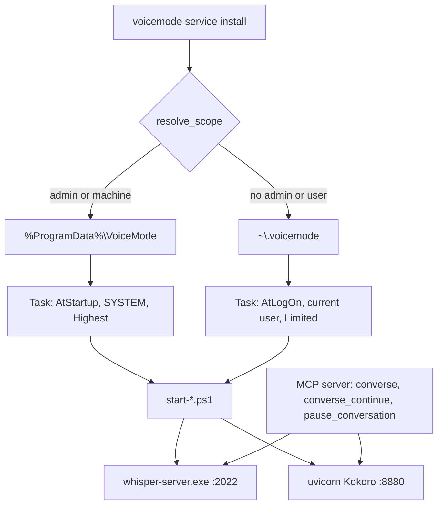
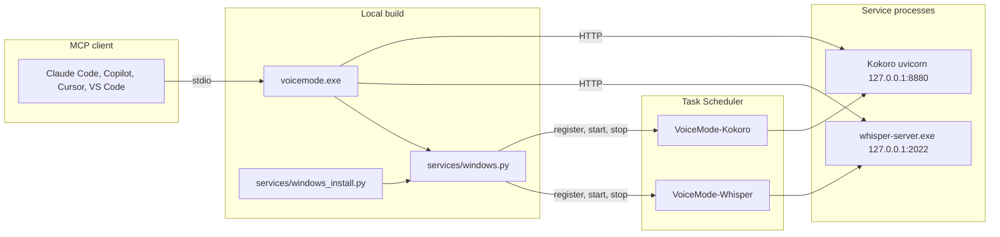
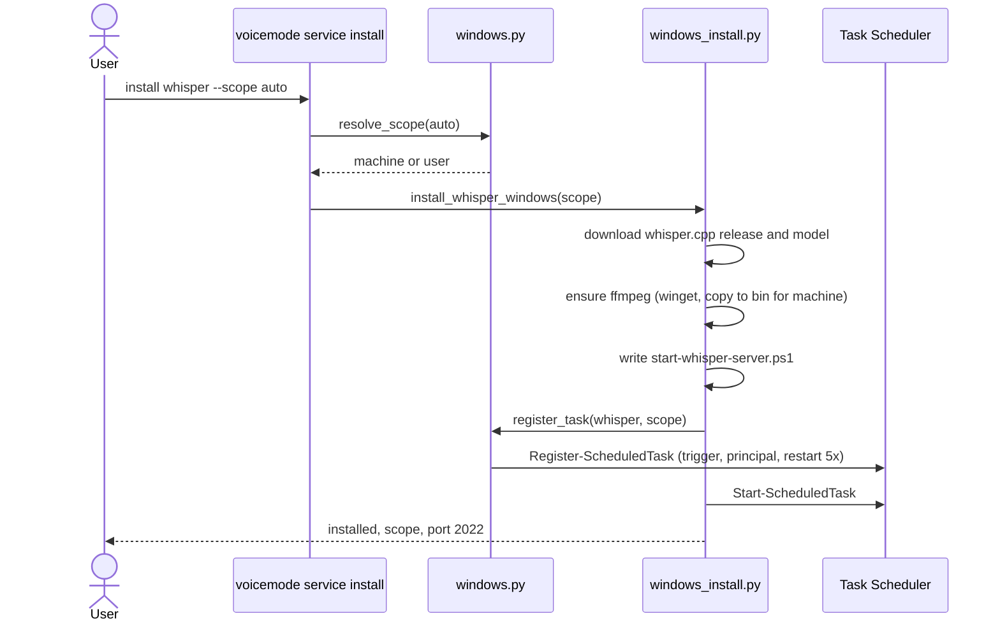
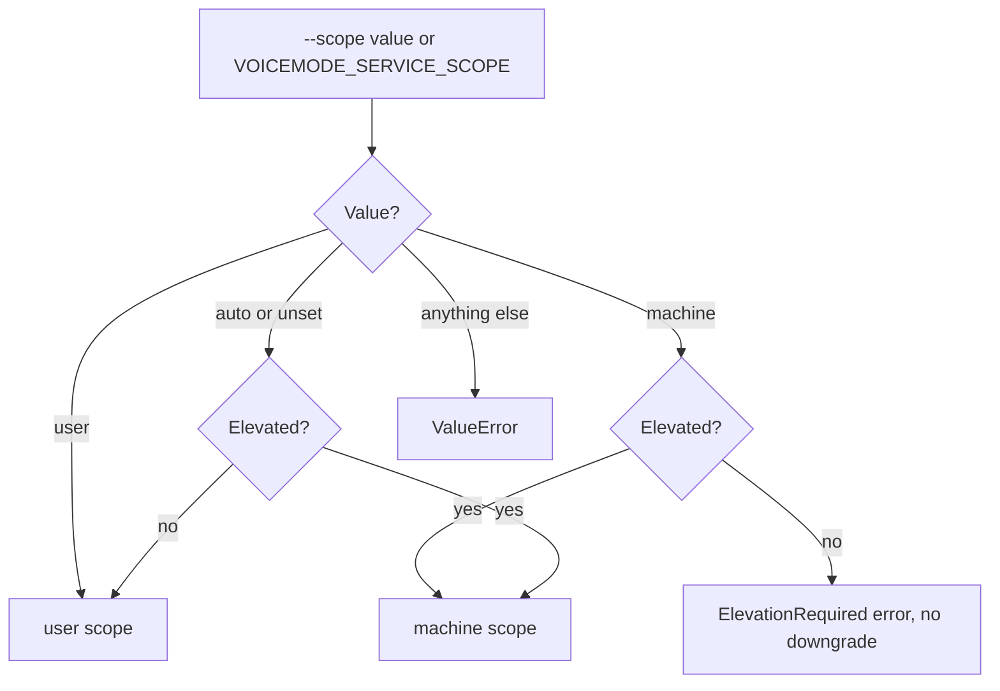
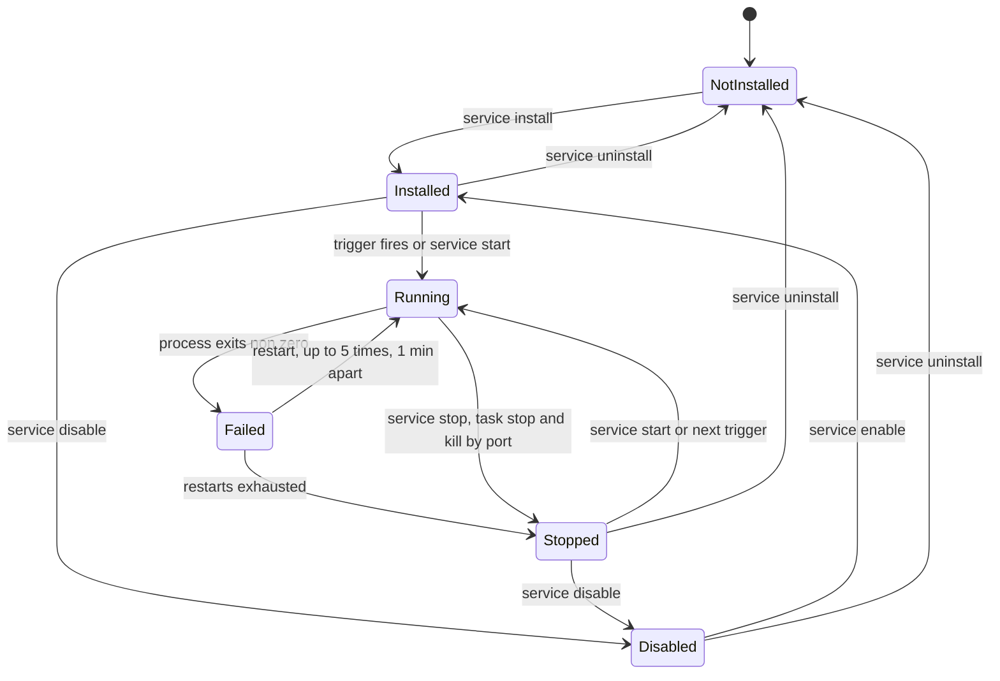

# ADR 0001: Windows hosts local Whisper and Kokoro, scoped by privilege

- Status: Accepted
- Date: 2026-11-13
- Related: [ADR 0002](0002-run-mcp-from-local-build.md), [ADR 0003](0003-windows-console-and-portability.md), [ADR 0004](0004-installer-multi-platform-scope.md)
- Supersedes: the earlier "Windows is a client only" decision in the installer

## Context

Native Windows used to be treated as a VoiceMode *client only*: the installer skipped
Whisper (speech-to-text, STT) and Kokoro (text-to-speech, TTS) and told users to point at
another machine. In practice users want the whole stack on their own PC, offline, with no
audio leaving the machine.

The POSIX installers do not work on Windows:

- They compile whisper.cpp with `cmake` and a C++ toolchain.
- They write launchd plists or systemd units.
- They run `.sh` start scripts.
- They call `os.uname()`, `os.getuid()` and `which`, none of which exist on Windows.

A console-encoding crash (cp1252 cannot encode the emoji in CLI output) also hid the real
errors; see [ADR 0003](0003-windows-console-and-portability.md).

Many Windows users, especially on corporate laptops, have **no administrator rights**.
The design must work fully without admin and use admin rights only when they are present.

## Decision drivers

1. Must work without administrator rights.
2. Must use admin rights, when present, to give a machine-wide, boot-time install.
3. No machine-wide prerequisites (no compiler, no eSpeak NG installer, no extra service
   manager to download).
4. Services restart on crash and run without a visible console window.
5. Same behaviour model as macOS/Linux (`voicemode service start|stop|status|logs`).
6. Safe by default: bind to loopback only, never evaluate user-editable config.
7. Works behind corporate TLS inspection.

## Decision

1. **Windows is a full install target.** `voicemode service install whisper|kokoro|voicemode`
   works on Windows. `should_recommend_local_services()` now applies the same hardware
   rules everywhere.
2. **Two scopes, one code path** (`voice_mode/utils/services/windows.py`):

   | | `user` (no admin) | `machine` (admin) |
   |---|---|---|
   | Data | `~\.voicemode` | `%ProgramData%\VoiceMode` |
   | Scheduled Task | `VoiceMode-<Svc>`, trigger at logon | `VoiceMode-<Svc>`, trigger at startup |
   | Runs as | current user, Interactive, `Limited` | `SYSTEM`, `Highest` |
   | Chosen when | not elevated | elevated |

   Both scopes restart the task up to 5 times, 1 minute apart, and have no execution time
   limit. `--scope auto|user|machine` (and `VOICEMODE_SERVICE_SCOPE`) override the choice.
   Asking for `machine` without elevation raises `ElevationRequired` with a clear message
   and **never silently downgrades** to `user`.
3. **Task Scheduler is the service manager.** It needs no extra software, runs without a
   console, restarts on failure and works per user without admin.
4. **No machine-wide prerequisites.**
   - Whisper uses the official prebuilt whisper.cpp release (no compiler), port 2022.
   - Kokoro uses a venv created with `uv venv --python 3.12` and `espeakng-loader` (no
     eSpeak NG installer), CPU only, port 8880. Git is needed to fetch Kokoro-FastAPI.
   - ffmpeg comes from winget (`Gyan.FFmpeg`). Whisper runs with `--convert`, which needs
     ffmpeg on `PATH`. In machine scope ffmpeg is copied to `<base>\bin` because `SYSTEM`
     does not see the user's `PATH`.
   - `uv` needs `UV_SYSTEM_CERTS=1` behind corporate TLS inspection; the installers set it
     for the uv commands they run.
5. **Run local code, not upstream.** Status, installer hints and the Windows serve service
   record and use the installed `voicemode.exe` instead of `uvx voice-mode`
   ([ADR 0002](0002-run-mcp-from-local-build.md)).
6. **UTF-8 console.** `harden_windows_console()` reconfigures stdout/stderr to UTF-8 with
   `errors="replace"` ([ADR 0003](0003-windows-console-and-portability.md)).
7. **Security.** The PowerShell start scripts read `voicemode.env` as inert `KEY=VALUE`
   data and never evaluate it (GHSA-h97v-r3jw-cf6f). Services bind to `127.0.0.1`.
8. **Stop kills by port too.** `Stop-ScheduledTask` may leave the server child process
   alive, so `voicemode service stop` also terminates the process that owns the service
   port.
9. **Logs** go to `<base>\logs\<service>\` (`startup.log`, `<service>.out.log`,
   `<service>.err.log`).

## Alternatives considered

| Alternative | Why it was rejected |
|---|---|
| **Real Windows Service via NSSM or WinSW** | Needs a third-party binary to download and trust, and *always* needs admin to register. Fails requirement 1. Adds an update and supply-chain burden. Task Scheduler gives restart-on-failure natively. |
| **Startup folder shortcut or `Run` registry key** | No restart on crash, no boot-time option, no machine scope, hard to query status or disable cleanly. Shows a console window unless wrapped. |
| **WSL2 running the Linux services** | Requires WSL and a distro (often blocked or needing admin), splits audio and file paths across two OSes, and WSL does not start at boot by default. |
| **Docker / Docker Desktop** | Heavy install, licensing for larger companies, needs admin and virtualization, slow cold start, and GPU/audio passthrough adds more problems than it solves. |
| **Per-OS only (keep Windows as client)** | Leaves Windows users dependent on another host and defeats the offline, private use case. |
| **Always require admin (machine scope only)** | Excludes the many users without admin rights. |
| **Always user scope** | Cannot start at boot, and a shared PC would carry one copy per user. |

## Consequences

Positive:

- Works for admin and non-admin users with the same commands.
- No extra software besides `uv`, git (Kokoro) and, via winget, ffmpeg.
- Local, offline speech on Windows.

Negative and limits:

- Linux/macOS stay on user-level systemd/launchd; a system-wide scope there is future work
  ([ADR 0004](0004-installer-multi-platform-scope.md)).
- Kokoro is CPU-only on Windows; GPU builds are future work.
- User scope only runs while the user is logged on (see the scenarios below).
- LiveKit and mlx-audio are out of scope on Windows and unchanged.
- Machine-scope data under `%ProgramData%` is shared by all accounts; read access is
  granted to `Users`.

### Verification status

Verified: user-scope install, service health, and a TTS to STT round trip.

**Not verified:** machine scope (needs an elevated shell, which the maintainer's machine
does not offer), a real reboot or logoff/logon autostart, Linux/macOS system-wide scope,
and GPU on Windows. Treat those paths as untested until someone runs them.

## User scenarios

| Scenario | What happens |
|---|---|
| **Admin install** | Run `voice-mode-install` (or `voicemode service install ... --scope auto`) from an elevated shell. Scope resolves to `machine`; data goes to `%ProgramData%\VoiceMode`; tasks start at boot as SYSTEM. |
| **Non-admin install** | Same commands in a normal shell. Scope resolves to `user`; data goes to `~\.voicemode`; tasks start when you log on. |
| **Machine requested, shell not elevated** | `ElevationRequired` error. Nothing is installed. Re-run elevated or pass `--scope user`. |
| **Upgrade** | `git pull`, then reinstall the editable tool (`uv tool install --editable C:\wgr\voice-patch --force`). Re-run `voicemode service install <svc> --force` if the service files (start scripts) changed. |
| **Uninstall** | `voicemode service uninstall <svc>` removes the task and files from whichever scope it was installed in. |
| **Reboot or logon** | Machine scope: tasks start at boot before anyone logs in. User scope: tasks start at logon. Verify with `voicemode status` or `Get-ScheduledTask VoiceMode-*`. |
| **Corporate TLS inspection** | `uv` downloads fail with certificate errors. The installers set `UV_SYSTEM_CERTS=1` so uv trusts the Windows certificate store. Set it yourself for manual `uv` runs. |
| **No ffmpeg** | The installer runs `winget install Gyan.FFmpeg`. If winget is missing or blocked, install ffmpeg manually and put `ffmpeg.exe` on `PATH` (or in `<base>\bin`). Whisper then works with `--convert`. |

## Diagrams

### Architecture

### Components

### Install sequence

### Scope decision

### Service lifecycle

See also the [Windows local services guide](../../guides/windows-local-services.md) and
[Windows workflows](../windows-workflows.md).
