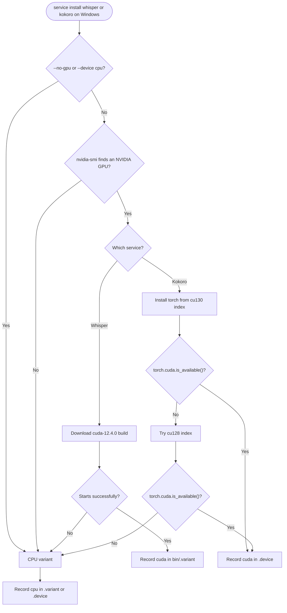
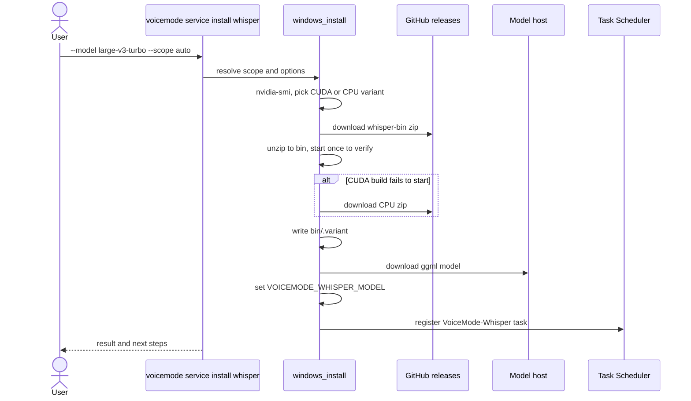

# ADR 0005: Unified service install CLI and GPU variants

- Status: Accepted
- Date: 2026-11-13
- Related: [ADR 0001](0001-windows-local-services.md), [ADR 0004](0004-installer-multi-platform-scope.md)

## Context

1. **One flat command, many services.** `voicemode service install SERVICE` was a single
   command that had to accept the union of every service's options. `--help` could not say
   which option belonged to which service (`--model` is Whisper only, `--device` is Kokoro
   only, `--bind-lan` is mlx-audio only), and options were silently ignored for the wrong
   service.
2. **No way to choose the Whisper model at install.** The model was downloaded but not
   activated, so a fresh install could still transcribe with a different model than the
   one the user asked for.
3. **Windows ran on the CPU.** The machine had an NVIDIA GPU (RTX PRO 500, Blackwell, 6 GB)
   but Whisper used the CPU build and Kokoro used CPU torch. Upstream Kokoro-FastAPI pins
   CUDA 12.4 wheels (`cu124`), which do not contain kernels for Blackwell GPUs.
4. **Intel iGPU and NPU** are present too, but neither whisper.cpp nor PyTorch (as shipped
   here) can use them.

## Decision

### CLI: `service install` becomes a group

`voicemode service install` is a click group with one subcommand per service. Each
subcommand declares only its own options. Old invocations such as
`voicemode service install whisper --force` keep working because the subcommand names and
shared option names are unchanged.

| Subcommand | Options |
|---|---|
| `whisper` | `--model` (tiny, tiny.en, base, base.en, small, small.en, medium, medium.en, large-v1, large-v2, large-v3, large-v3-turbo; default `base`), `--no-model`, `--use-gpu/--no-gpu`, `--install-dir`, `--version`, `--auto-enable`, `--skip-core-ml`, `--skip-deps`, `--force`, `--scope` |
| `kokoro` | `--device auto\|cpu\|gpu` (Windows), `--install-dir`, `--models-dir`, `--port`, `--no-models`, `--version`, `--auto-enable`, `--skip-deps`, `--force`, `--scope` |
| `voicemode` | `--auto-enable`, `--scope` |
| `mlx-audio` | `--port`, `--bind-lan`, `--auto-enable`, `--force` |
| `livekit` | unchanged |

`voicemode service install --help` lists the services; `voicemode service install <svc>
--help` shows that service's options (Whisper's epilog lists every model with its size:
tiny 39 MB, base 142 MB, small 466 MB, medium 1.5 GB, large-v2 2.9 GB, large-v3 3.1 GB,
large-v3-turbo 1.6 GB).

Installing Whisper now also **activates** the chosen model by writing
`VOICEMODE_WHISPER_MODEL`, so the model that was downloaded is the model that is used.

### Windows GPU variants

- **Whisper.** If `nvidia-smi` finds an NVIDIA GPU, install the prebuilt
  `whisper-bin-win-cuda-12.4.0-x64.zip`, and start it once to verify it runs. If no GPU is
  found, or the CUDA build fails to start, install the CPU build. The result is recorded
  in `bin\.variant`.
- **Kokoro.** Install torch CUDA wheels from `download.pytorch.org/whl/cu130`, then
  `cu128` if that fails (upstream's pinned `cu124` lacks Blackwell). Verify with
  `torch.cuda.is_available()`; if it is false, fall back to CPU torch. The result is
  recorded in `<kokoro>\.device` and read by `start-kokoro.ps1`. The environment variable
  `VOICEMODE_KOKORO_DEVICE` overrides the file. `--device cpu` skips GPU probing,
  `--device gpu` insists on it, `auto` is the default.
- **Intel iGPU/NPU** are not used; the runtimes do not support them.

### Warm-up

The first Whisper request on a GPU architecture new to the CUDA build takes about
**45 seconds** because CUDA kernels are JIT-compiled. Later requests are fast. This is
expected and is not a hang.

Verified on the RTX PRO 500 Blackwell laptop GPU (6 GB): Kokoro on `cuda`, Whisper
large-v3-turbo on `CUDA0`; warm timings about 0.8 s STT and 0.2 s TTS.

### Recommended model

`large-v3-turbo` (`voicemode whisper model large-v3-turbo`) is the most accurate practical
choice; it is much smaller and faster than large-v3. `voicemode whisper model` also no
longer calls POSIX `pgrep` when switching models on Windows.

## Alternatives considered

| Alternative | Why it was rejected |
|---|---|
| Keep one flat command with the union of all options | `--help` is misleading; options for other services are silently ignored; every new service makes it worse. |
| Separate top-level commands per service | Breaks `service install X` muscle memory and docs; the group keeps both. |
| Always install the CUDA build | Fails on machines without NVIDIA drivers; no safe fallback. |
| Use Kokoro's pinned `cu124` wheels | No Blackwell kernels, so CUDA is reported available but kernels fail or fall back. |
| Probe the GPU at every service start | Slow start-up; the verified result is recorded once and overridable by env var. |
| Target Intel iGPU/NPU via OpenVINO or DirectML | Not supported by whisper.cpp prebuilds or this torch setup; large new dependency. |

## Consequences

- Scripts and docs that used `service install whisper --force` still work.
- Options for a service now appear only under that service, and typos fail loudly.
- GPU installs download more (CUDA zip, torch CUDA wheels are large) and are verified; a
  failure degrades to CPU with a message, never to a broken service.
- Users on new GPU architectures should expect the one-time warm-up.
- The CUDA index order (`cu130`, `cu128`) will need revisiting as torch releases move.
- Changing hardware (new GPU, driver) needs `service install <svc> --force` to re-detect.

## User scenarios

| Scenario | Command | Result |
|---|---|---|
| Laptop with NVIDIA GPU, best accuracy | `voicemode service install whisper --model large-v3-turbo` and `voicemode service install kokoro` | CUDA builds, verified; check logs for `CUDA0` and `cuda` |
| No GPU or driver | same commands | CPU builds; `.variant` and `.device` say `cpu` |
| Force CPU on a GPU machine | `... whisper --no-gpu`, `... kokoro --device cpu` | CPU variants |
| Save disk and bandwidth | `voicemode service install whisper --model tiny` | 39 MB model |
| Change model later | `voicemode whisper model large-v3-turbo` | Model downloaded and activated |
| Override Kokoro device once | `$env:VOICEMODE_KOKORO_DEVICE = "cpu"` | Wins over `.device` |
| Not sure of options | `voicemode service install whisper --help` | Per-service options and model table |
