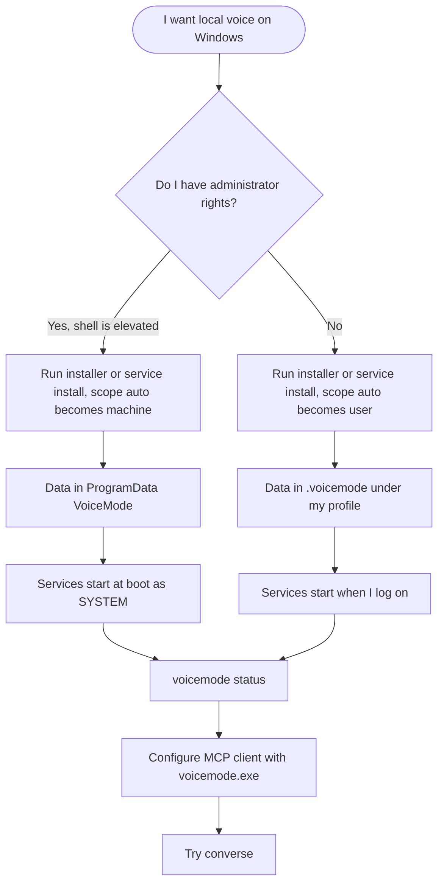
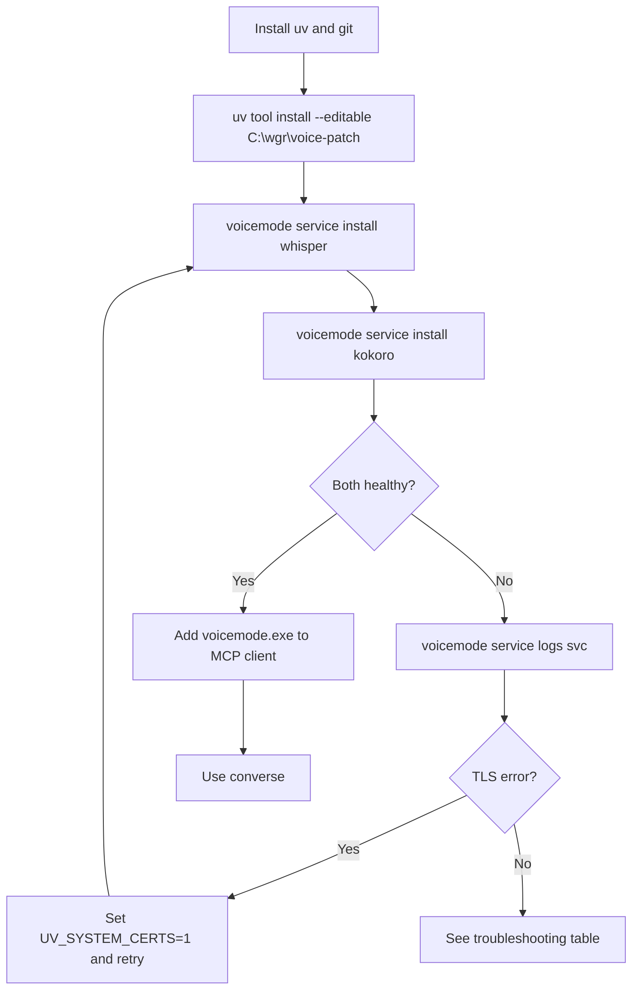
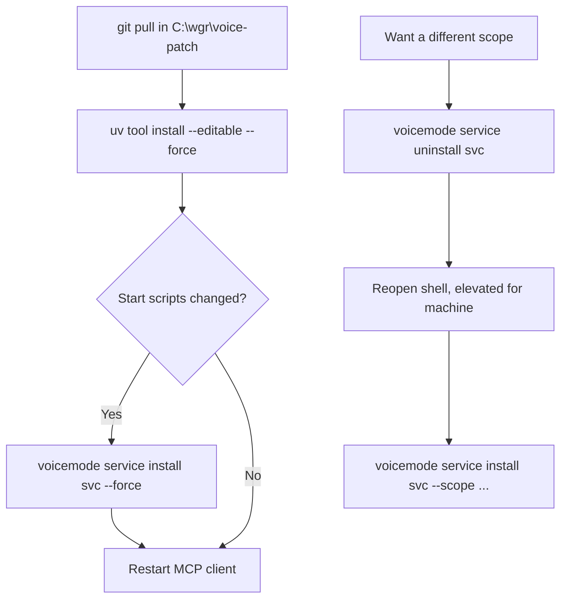
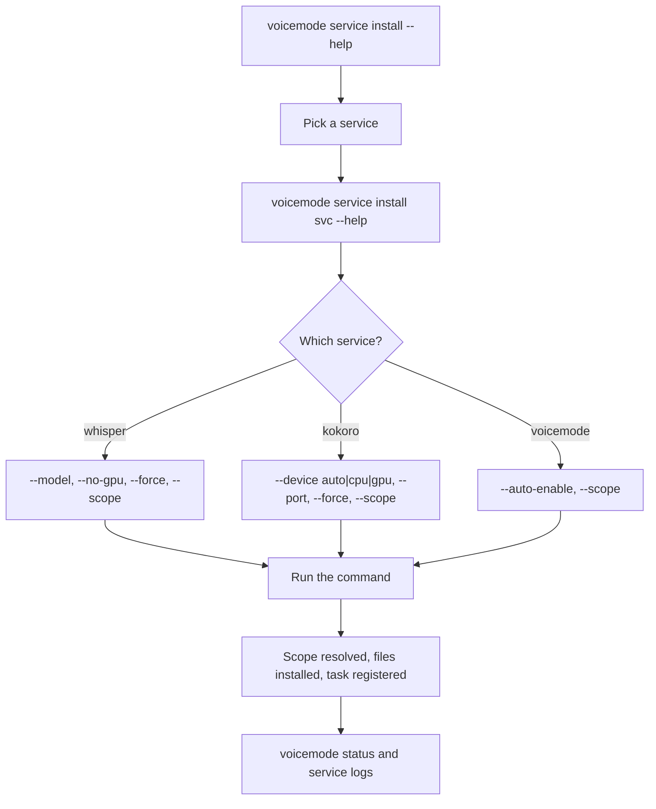
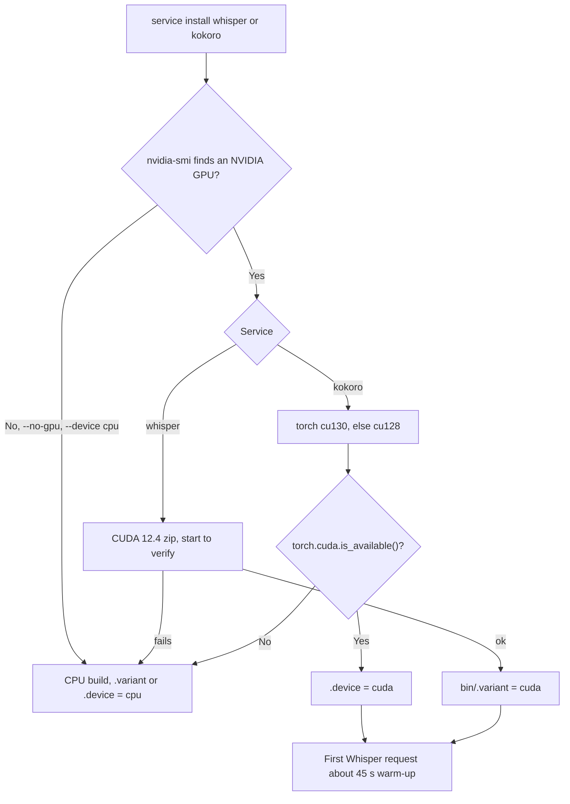
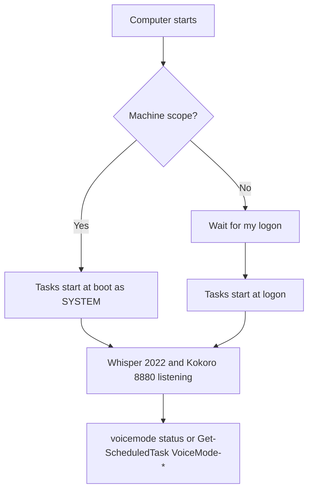
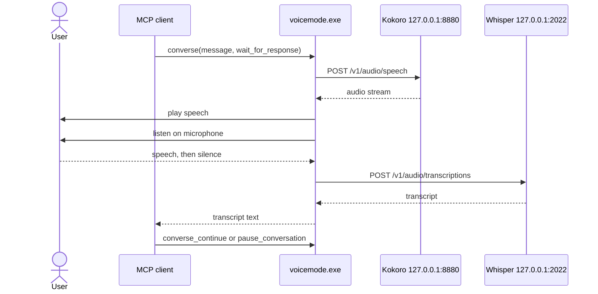
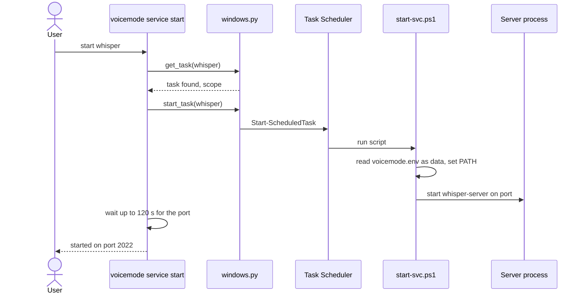
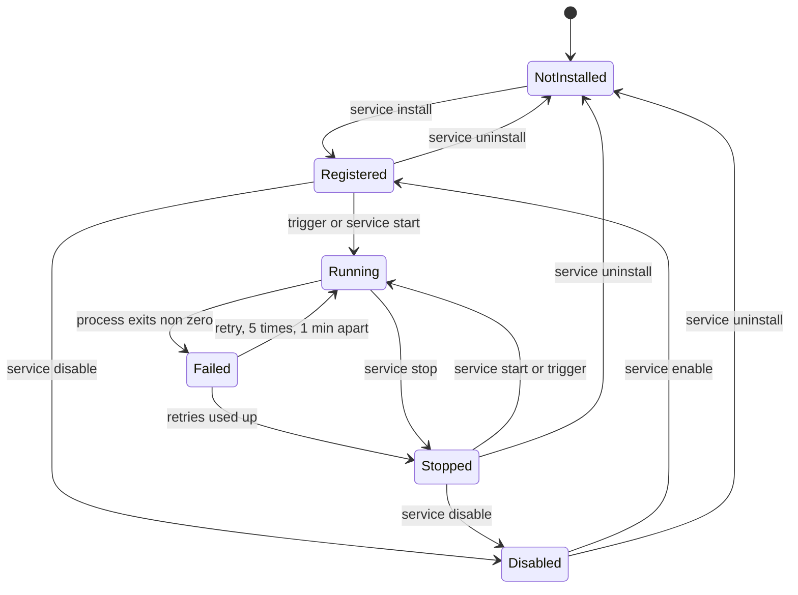

# Windows Workflows

Diagrams for the Windows local-services design. For commands see the
[user guide](../guides/windows-local-services.md); for reasons see
[ADR 0001](adr/0001-windows-local-services.md).

## Which install path am I on?

## User journeys

### First install, no admin

### Upgrade or switch scope

### Install with options

### GPU selection

See [ADR 0005](adr/0005-unified-service-install-cli-and-gpu-variants.md).

### After logon or reboot

## Sequence: a converse call

## Sequence: starting a service

## Task lifecycle

In machine scope the trigger is "at startup" and the account is SYSTEM; in user scope the
trigger is "at logon" and the account is you. Both have no time limit.
