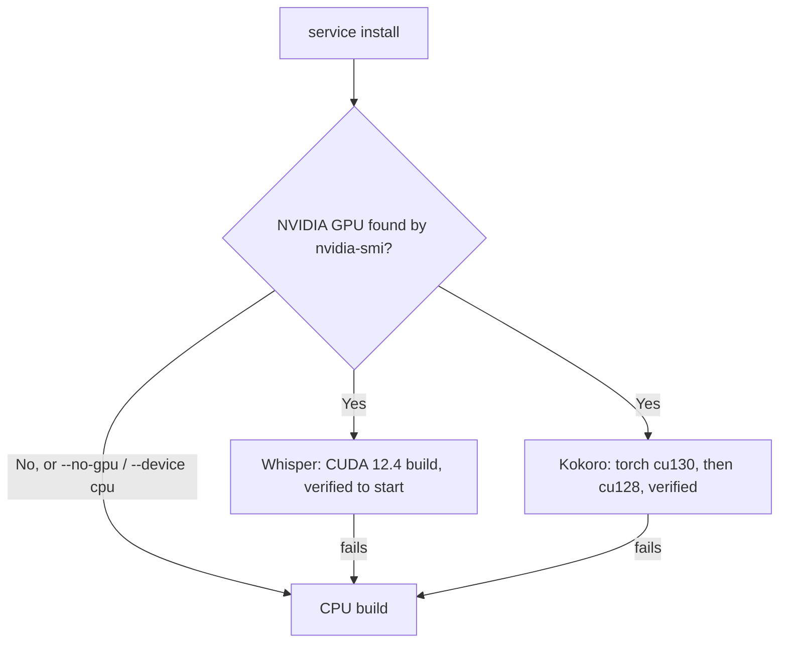

# Windows Local Services

Run VoiceMode's speech services on your own Windows PC: Whisper for speech-to-text
(port 2022) and Kokoro for text-to-speech (port 8880). Audio never leaves the machine.
The services run as Windows Scheduled Tasks, so no extra service software is needed.

Design background: [ADR 0001](../architecture/adr/0001-windows-local-services.md).
Diagrams: [Windows workflows](../architecture/windows-workflows.md).

## What is and is not verified

| Verified | Not verified yet |
|---|---|
| User-scope install, service health, TTS to STT round trip | Machine scope (needs an elevated shell) |
| | A real reboot or logoff/logon autostart |
| GPU: Whisper (CUDA build) and Kokoro (CUDA torch) on an RTX PRO 500 Blackwell laptop GPU | GPU on other NVIDIA generations; Intel iGPU/NPU (not supported by these runtimes) |
| | Linux/macOS system-wide scope (those stay on user launchd/systemd) |

LiveKit is out of scope on Windows.

## Prerequisites

- Windows 10 or 11 with PowerShell.
- [uv](https://docs.astral.sh/uv/) (Python package manager).
- git (needed to fetch Kokoro-FastAPI); `winget install Git.Git`.
- A microphone and speakers.
- ffmpeg is installed for you with winget (`Gyan.FFmpeg`). Without winget, install it by
  hand and put `ffmpeg.exe` on `PATH`.
- Behind corporate TLS inspection, set `UV_SYSTEM_CERTS=1` before running `uv` yourself:

  ```powershell
  $env:UV_SYSTEM_CERTS = "1"
  ```

PortAudio is bundled with the `sounddevice` package; no separate install is needed.

## Install the local build

```powershell
cd C:\wgr\voice-patch
$env:UV_SYSTEM_CERTS = "1"
uv tool install --editable C:\wgr\voice-patch
```

This creates `C:\Users\<user>\.local\bin\voicemode.exe`. MCP clients run this file
([ADR 0002](../architecture/adr/0002-run-mcp-from-local-build.md)).

## Install the services

Pick the scope by how you start PowerShell.

| | User scope (normal shell) | Machine scope (Run as administrator) |
|---|---|---|
| Data | `~\.voicemode` | `%ProgramData%\VoiceMode` |
| Starts | when you log on | when the PC boots |
| Runs as | you, limited | SYSTEM |
| Needs admin | No | Yes |

```powershell
# Automatic: machine scope if elevated, otherwise user scope
voicemode service install whisper
voicemode service install kokoro

# Explicit
voicemode service install whisper --scope user
voicemode service install kokoro  --scope machine   # elevated shell only
```

`--scope` accepts `auto`, `user` or `machine`; `VOICEMODE_SERVICE_SCOPE` sets the default.
Asking for `machine` in a normal shell fails with an elevation error. It never quietly
falls back to user scope.

### Install options

`voicemode service install` is a group: each service has its own options. Run
`voicemode service install --help` to list the services and
`voicemode service install <service> --help` for that service's options. Older commands
such as `voicemode service install whisper --force` still work.

| Service | Options |
|---|---|
| `whisper` | `--model` (default `base`), `--no-model`, `--use-gpu/--no-gpu`, `--install-dir`, `--version`, `--auto-enable`, `--skip-core-ml`, `--skip-deps`, `--force`, `--scope` |
| `kokoro` | `--device auto\|cpu\|gpu`, `--install-dir`, `--models-dir`, `--port`, `--no-models`, `--version`, `--auto-enable`, `--skip-deps`, `--force`, `--scope` |
| `voicemode` | `--auto-enable`, `--scope` |
| `mlx-audio` | `--port`, `--bind-lan`, `--auto-enable`, `--force` (not used on Windows) |
| `livekit` | unchanged (not supported on Windows) |

Whisper models: `tiny` (39 MB), `base` (142 MB, default), `small` (466 MB), `medium`
(1.5 GB), `large-v2` (2.9 GB), `large-v3` (3.1 GB) and `large-v3-turbo` (1.6 GB), plus
`.en` variants of the smaller ones. The chosen model is also activated
(`VOICEMODE_WHISPER_MODEL`). `large-v3-turbo` is the recommended choice:

```powershell
voicemode service install whisper --model large-v3-turbo
voicemode service install kokoro --device auto
voicemode whisper model large-v3-turbo     # switch an existing install
```

### GPU acceleration



- **Whisper** uses the prebuilt CUDA 12.4 build (`whisper-bin-win-cuda-12.4.0-x64.zip`)
  when an NVIDIA GPU is detected and it starts; otherwise the CPU build. The variant is
  recorded in `<whisper>\bin\.variant`.
- **Kokoro** installs torch CUDA wheels from `download.pytorch.org/whl/cu130`, then
  `cu128` (upstream's pinned `cu124` has no Blackwell support), checks
  `torch.cuda.is_available()`, and falls back to CPU torch. The device is recorded in
  `<kokoro>\.device`; `start-kokoro.ps1` reads it. Set `VOICEMODE_KOKORO_DEVICE` to
  override it.
- Intel iGPU and NPU are not used.
- Verify in the logs: Whisper's `startup.log`/`whisper.err.log` mention `CUDA0`, Kokoro's
  mention `cuda`. Warm timings on the tested laptop: about 0.8 s STT, 0.2 s TTS.
- **Expect a warm-up:** the first Whisper request takes about 45 seconds while CUDA kernels
  are compiled for a new GPU architecture. Later requests are fast.

Design: [ADR 0005](../architecture/adr/0005-unified-service-install-cli-and-gpu-variants.md).

Or run the installer, which detects admin rights and passes `--scope` for you:

```powershell
uvx --from C:\wgr\voice-patch\installer voice-mode-install --yes
```

Run it from an elevated shell for machine scope. The published `voice-mode-install` does
not yet contain the Windows service support, so use the local `installer` folder.

## Day-to-day commands

```powershell
voicemode service start whisper
voicemode service stop whisper
voicemode service restart whisper
voicemode service status whisper
voicemode service health whisper
voicemode service logs whisper --lines 100
voicemode service enable whisper      # turn autostart on
voicemode service disable whisper     # turn autostart off
voicemode service uninstall whisper   # remove task and files
voicemode status                      # overview of both services and the runtime command
```

Use `kokoro` in place of `whisper` for the speech service.

Logs live in `<base>\logs\<service>\`: `startup.log`, `<service>.out.log` and
`<service>.err.log`, where `<base>` is `~\.voicemode` or `%ProgramData%\VoiceMode`.

Settings (ports, model, host) come from `<base>\voicemode.env`. The start scripts read it
as plain `KEY=VALUE` data and never run it as code. Services bind to `127.0.0.1`.

## What "logon autostart" and "boot autostart" mean

- **Logon autostart (user scope):** the services start by themselves each time *you* sign
  in to Windows. If nobody is signed in (for example right after a reboot at the login
  screen) they are not running.
- **Boot autostart (machine scope):** the services start when the computer starts, before
  anyone signs in, and keep running for every user.
- Either way, if a service crashes Windows restarts it up to 5 times, one minute apart.

### How to test autostart

1. Check the tasks exist:

   ```powershell
   Get-ScheduledTask VoiceMode-*
   ```

2. Sign out and back in (user scope) or reboot (machine scope).
3. Wait a minute or two (Kokoro takes longest), then run:

   ```powershell
   voicemode status
   Get-ScheduledTaskInfo -TaskName VoiceMode-Whisper
   ```

Both services should show running. This has not yet been verified on a real reboot, so
please report what you see.

## Connect an MCP client

Point the client at the installed executable, not `uvx voice-mode`. Replace `<user>`.

| Client | Where | Setting |
|---|---|---|
| Claude Code | command line | `claude mcp add --scope user voicemode -- "C:\Users\<user>\.local\bin\voicemode.exe"` |
| GitHub Copilot CLI | `~/.copilot/mcp-config.json` | `mcpServers.voicemode` with `type: local`, `command`, `args: []`, `tools: ["*"]` |
| VS Code | `mcp.json` | `servers.voicemode` with `type: stdio`, `command`, `args: []` |
| Cursor | `~/.cursor/mcp.json` | `mcpServers.voicemode` with `command`, `args: []` |
| Claude Desktop | `%APPDATA%\Claude\claude_desktop_config.json` | `mcpServers.voicemode` with `command`, `args: []` |

Full JSON examples are in [ADR 0002](../architecture/adr/0002-run-mcp-from-local-build.md).
Use doubled backslashes in JSON. Restart the client afterwards.

## Test the voice tools

1. Run `voicemode status`; both services should be running.
2. In the client, ask the agent to call `converse` with a short message and
   `wait_for_response=true`, then speak when prompted. You should hear Kokoro and see your
   words transcribed by Whisper.
3. Ask the agent to continue with `converse_continue` to keep the conversation going
   without restarting it.
4. Ask the agent to call `pause_conversation`; listening stops until the next `converse`.
5. Quick service-only check without a microphone: ask for a spoken reply with
   `wait_for_response=false`, which exercises Kokoro alone.

## Troubleshooting

| Symptom | Likely cause | Fix |
|---|---|---|
| `Machine-wide install needs an elevated shell` | `--scope machine` in a normal shell | Re-run as administrator, or use `--scope user` |
| `UnicodeEncodeError` or `charmap` errors | Old build without console hardening | Reinstall the local build ([ADR 0003](../architecture/adr/0003-windows-console-and-portability.md)) |
| Certificate or SSL errors from `uv` | Corporate TLS inspection | `$env:UV_SYSTEM_CERTS = "1"` and retry |
| Whisper log says ffmpeg not found | ffmpeg not on `PATH` for the service | `winget install Gyan.FFmpeg`, then reinstall the service; in machine scope it is copied to `<base>\bin` |
| `Model not found` in `startup.log` | Model download did not finish | `voicemode service install whisper --force` |
| Port 2022 or 8880 not listening | Task not started or crashed | `voicemode service logs <svc>`, then `voicemode service start <svc>` |
| Kokoro slow to start | First launch loads models (longer on CPU) | Wait a few minutes; check `kokoro.err.log` |
| First transcription takes about 45 s | CUDA kernel JIT for a new GPU architecture | Expected once; later requests take about 1 s |
| Running on CPU despite an NVIDIA GPU | Driver missing, `--no-gpu`/`--device cpu`, or CUDA verification failed | Check `nvidia-smi`, read `bin\.variant` and `.device`, then `service install <svc> --force` |
| Kokoro uses the wrong device | `VOICEMODE_KOKORO_DEVICE` or `.device` | Unset the variable or reinstall with `--device auto` |
| `pgrep` not found when switching model | Old build | Update; `voicemode whisper model` no longer uses it |
| `charmap` error in `converse_continue` | Old build wrote job files in cp1252 | Update; text I/O is UTF-8 ([ADR 0006](../architecture/adr/0006-cross-platform-terminal-and-log-portability.md)) |
| Terminal shows fewer log lines than on a Mac | Debug is configuration | Set `VOICEMODE_DEBUG=true` and `VOICEMODE_SAVE_ALL=true` in `~/.voicemode/voicemode.env` |
| `service stop` says still running | Child process outlived the task | Run it again; it also ends the process that owns the port |
| Client still uses old tools | Client launches `uvx voice-mode` | Switch its config to `voicemode.exe` and restart the client |
| `voicemode` not found | uv tool folder not on `PATH` | Use the full path `C:\Users\<user>\.local\bin\voicemode.exe` or run `uv tool update-shell` |
| Services not running after reboot | User scope waits for logon | Sign in, or reinstall as admin for boot start |
| Installed as user, now want machine | Scopes are separate | `voicemode service uninstall <svc>`, then reinstall elevated |

## DO and DON'T

DO:

- Run the installed `voicemode.exe` from MCP clients.
- Use `--scope user` if you have no admin rights.
- Use `voicemode status` and `voicemode service logs` before anything else when debugging.
- Set `UV_SYSTEM_CERTS=1` on corporate networks.
- Run `voicemode service install <service> --help` for options; pass `--model large-v3-turbo`.
- Check the logs for `CUDA0`/`cuda` to confirm GPU use.
- Keep `C:\wgr\voice-patch` in place; the editable install points at it.

DON'T:

- Don't expect machine scope to work from a non-elevated shell; it will error, by design.
- Don't put code in `voicemode.env` expecting it to run; it is read as data only.
- Don't bind services to `0.0.0.0` unless you understand the exposure.
- Don't edit the Scheduled Tasks by hand; use `voicemode service` so the scope, trigger and
  restart policy stay consistent.
- Don't install the same service in both scopes at once.
- Don't mistake the 45 s first Whisper request on GPU for a hang.
